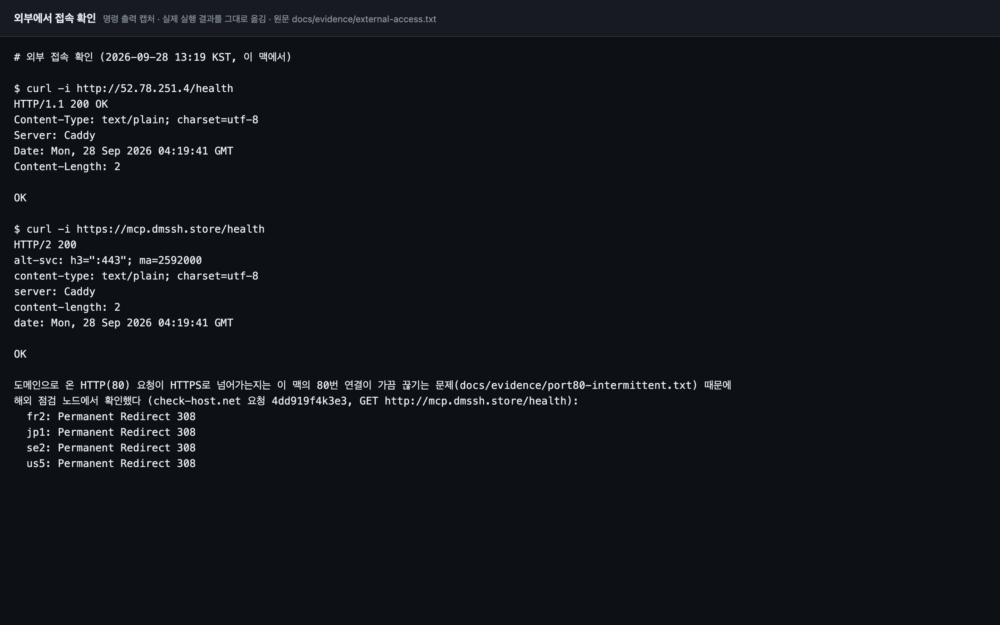
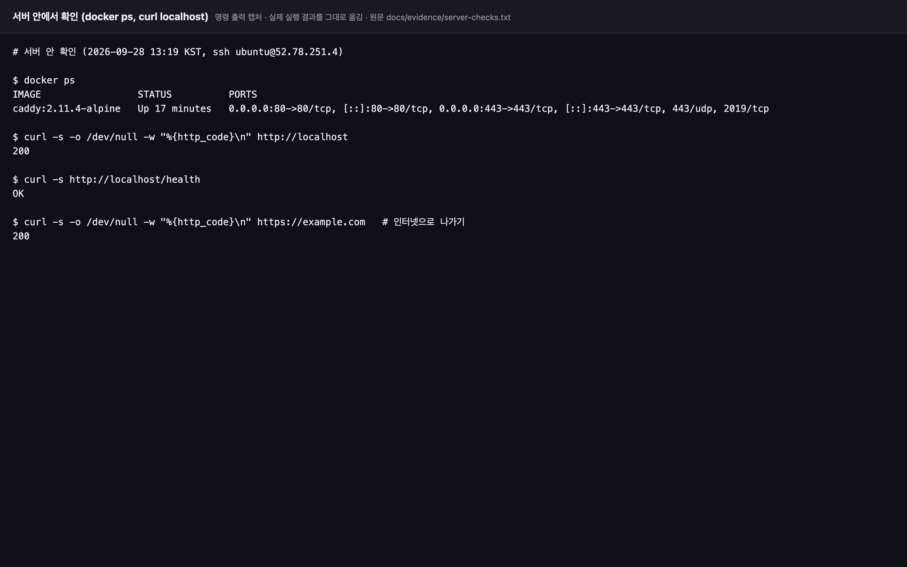
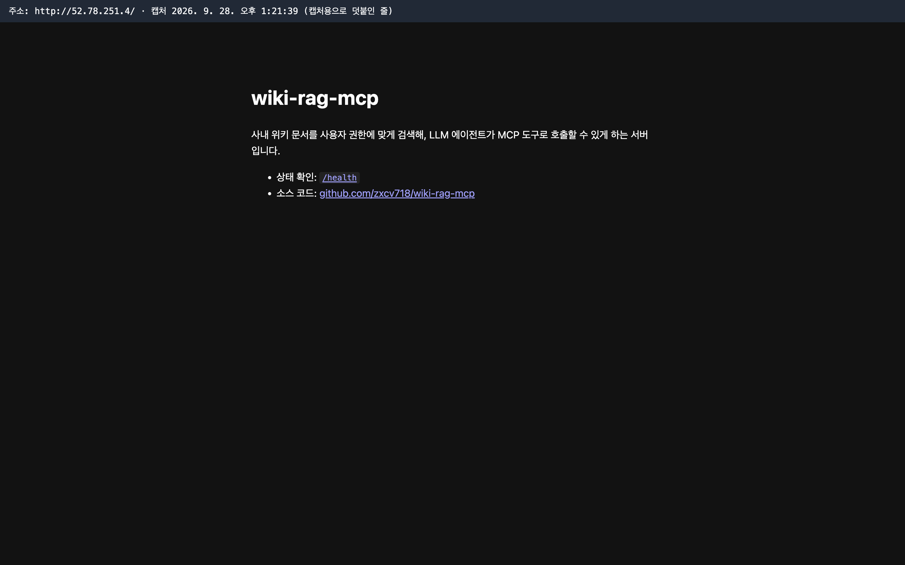
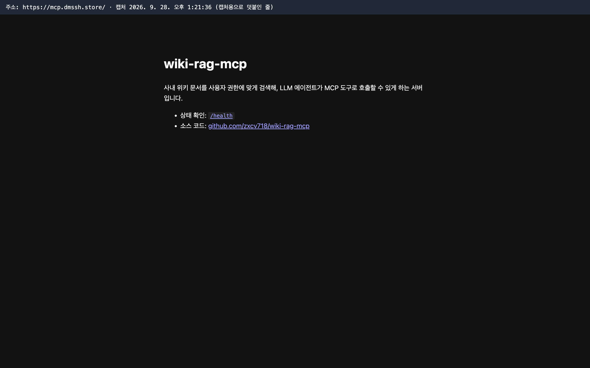
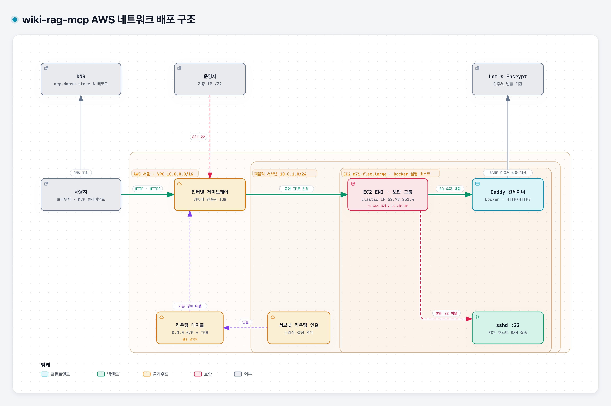

# wiki-rag-mcp — AWS 클라우드 배포 (B3-1)

사내 위키를 사용자 권한에 맞게 검색하는 MCP 서버를 AWS 서울 리전의 EC2에 배포한 프로젝트입니다. 코디세이 B3-1 「내가 만든 웹사이트를 인터넷에 올려 누구나 쓰게 하기」의 제출물과 검증 방법을 이 README에 모았습니다.

외부에 공개하는 웹 페이지와 `/health`는 로그인 없이 확인할 수 있습니다. 위키 검색은 OAuth 로그인이 필요합니다. 검색 서버의 동작과 실험 결과는 [사내 위키 검색 서버 설명](docs/project-overview.md)에 있습니다.

## 제출물과 증빙

| 과제 제출물 | 파일·선택 방식 | 확인할 내용 |
|---|---|---|
| 아키텍처 다이어그램 1장 | [docs/architecture.png](docs/architecture.png) | VPC, Public Subnet, Internet Gateway, EC2, Security Group과 외부 요청 흐름 |
| 외부 접속 증빙 | **방식 B**: `GET http://<퍼블릭 IP>/health` | `200 OK`, 고정 본문 `OK`. [스크린샷](docs/evidence/terminal-external-access.png), [원본 출력](docs/evidence/external-access.txt) |
| 트러블슈팅 보고서 | [docs/troubleshooting.md](docs/troubleshooting.md) | 실제 문제 4건의 증상 → 가설 → 검증 → 조치 → 결과 → 재발 방지 |
| 리소스 정리 체크리스트 | [docs/cleanup-checklist.md](docs/cleanup-checklist.md) | EC2·EBS·Elastic IP·IGW·VPC의 삭제 순서와 실행 기록 |

리소스 정리는 **2026-10-28**에 했습니다. Terraform 자원 13개를 모두 지우고 잔여 자원 점검이 모두 0인 것을 확인한 뒤, 같은 코드로 다시 만들었습니다. 접속 스크린샷은 정리 전 서버의 **2026-09-28 기록**입니다.

## 실행과 검증

서버는 Terraform(`default` workspace)으로 만든 EC2 한 대입니다. 2026-10-28에 [정리 체크리스트](docs/cleanup-checklist.md)대로 모든 자원을 지운 뒤, 같은 코드로 다시 만들었습니다.

| 구분 | 내용 |
|---|---|
| EC2 / EBS | `m7i-flex.large` / gp3 20GiB |
| 서버 안 | Caddy, 검색 서버, 위키 서비스, 워커, DB, Redis, 관측성 도구 (Docker Compose) |
| 주소 | Elastic IP `54.116.149.126`, `mcp.dmssh.store`, `auth.dmssh.store` |

만들고 배포하는 절차는 [검색 서버 설명의 "운영 스택 배포"](docs/project-overview.md#운영-스택-배포)에 있습니다. 최소 권한 IAM 사용자 `wiki-rag-deployer`의 AWS CLI 프로필 `wiki-rag`로 실행하며, 관리자 권한은 부여하지 않습니다.

노트북에서 확인합니다.

```bash
curl -i http://54.116.149.126/health   # HTTP/1.1 200 OK, 본문 OK
ssh -i ~/.ssh/wiki-rag-m5.pem ubuntu@54.116.149.126
```

SSH 접속 후 서버 안에서도 확인합니다.

```bash
docker ps --filter name=caddy          # caddy:2.11.4-alpine, Up, 80·443 매핑
curl -i http://localhost               # 200
curl -i http://localhost/health        # 200, 본문 OK
curl -I https://example.com            # 인터넷 아웃바운드 연결 확인
```

## 외부 접속 검증

**선택한 방식은 B**입니다. 보안 그룹의 80번 허용, Elastic IP, IGW와 기본 라우팅, Docker 포트 매핑, Caddy의 `respond /health "OK" 200`을 연결해 고정 응답으로 판정합니다. 방식 A의 소개 페이지도 같은 서버에서 확인할 수 있습니다.

| 대상 | 주소 | 기대 결과 |
|---|---|---|
| HTTP (방식 B) | `http://54.116.149.126/health` | `200`, 본문 `OK` |
| 소개 페이지 (방식 A) | `http://54.116.149.126` | 소개 페이지 표시 |
| HTTPS (보너스 1) | `https://mcp.dmssh.store/health` | 정식 인증서로 `200`, 본문 `OK` |
| 도메인 HTTP | `http://mcp.dmssh.store` | `308`로 HTTPS에 연결 |

아래 스크린샷은 **2026-09-28에 정리 전 서버에서 찍은 기록**입니다. 당시 방식 B의 접속 주소는 `http://52.78.251.4/health`였고, 이 IP는 2026-10-28 정리 때 반납했습니다. 지금 주소는 위 표와 같습니다.

| 외부 접속: 노트북의 `curl -i` | 컨테이너 상태와 서버 내부 접속 |
|---|---|
|  |  |

| 방식 A: 공인 IP의 소개 페이지 | 보너스 1: 도메인 HTTPS |
|---|---|
|  |  |

주소·시각 띠는 캡처 때 덧붙인 것이며 페이지 자체에는 없습니다. [외부 접속 원본](docs/evidence/external-access.txt)과 [서버 내부 원본](docs/evidence/server-checks.txt)도 함께 보관합니다. `/health`의 고정 응답은 웹 서버까지 연결됐다는 증빙이며, 위키 검색 전체의 정상 동작을 뜻하지는 않습니다.

## 아키텍처



그림은 외부 접속 경로와 EC2 안에서 실행하는 Caddy·SSH 서버의 배치를 보여 줍니다. 검색 서버·DB 등 내부 서비스의 전체 구성은 [검색 서버 설명](docs/project-overview.md#구성)에 있습니다. 그림의 [원본 JSON](docs/architecture.archify.json)과 [확대해서 볼 수 있는 HTML](docs/architecture.html)도 보관합니다. GitHub에서는 HTML 소스가 표시되므로 내려받아 브라우저로 엽니다.

1. 도메인으로 접속하면 DNS가 Elastic IP를 알려 줍니다. IP로 직접 접속할 때는 이 단계를 거치지 않습니다.
2. 요청이 Internet Gateway를 거쳐 퍼블릭 서브넷의 EC2로 들어옵니다. EC2 네트워크 인터페이스(ENI)에 적용된 Security Group이 출처와 목적지 포트를 확인합니다.
3. 호스트의 80·443 포트가 Docker 포트 매핑을 통해 Caddy 컨테이너에 연결됩니다.
4. 운영자의 SSH 연결은 EC2 안의 SSH 서버 22번으로 갑니다. Caddy 컨테이너로 전달되지 않습니다.
5. 응답과 서버의 인터넷 요청은 서브넷 라우팅 테이블의 `0.0.0.0/0 → IGW` 경로로 나갑니다. 라우팅 테이블과 서브넷 사이의 선은 설정 연결이며, 패킷이 별도 장비를 통과한다는 뜻이 아닙니다. 공인 IP만 있고 이 경로가 없으면 인터넷 연결을 완성할 수 없습니다.

| 구성 | 설정 | 구현·증빙 |
|---|---|---|
| 리전 / 가용 영역 | 서울 `ap-northeast-2` / `ap-northeast-2a` | [변수](infra/variables.tf) |
| VPC / Public Subnet | `10.0.0.0/16` / `10.0.1.0/24` | [Terraform](infra/main.tf) |
| IGW / Route Table | VPC에 IGW 연결, 서브넷에 기본 경로 연결 | [Terraform](infra/main.tf) |
| EC2 / EBS | `m7i-flex.large`, Ubuntu 24.04 LTS, gp3 20GiB, 종료 시 볼륨 삭제 | [Terraform](infra/main.tf), [변수](infra/variables.tf) |
| 공인 IP | Elastic IP 1개, 삭제 때 반납 | [출력 정의](infra/outputs.tf), [정리 기록](docs/cleanup-checklist.md#정리-실행-기록) |
| 서버 부팅·배포 | 첫 부팅에 Docker 설치, 배포 스크립트가 저장소를 받아 Compose로 실행 | [cloud-init](infra/cloud-init.yaml), [배포 스크립트](deploy/push.sh) |

과제의 권장 사양(micro, 8~10GiB) 대신, 로컬 임베딩 모델 두 프로세스와 DB·위키 서비스를 위해 8GiB 메모리와 20GiB 디스크를 사용합니다. 선택 근거와 측정은 [ADR-23](docs/adr/ADR-23.md), 디스크 문제와 조치는 [트러블슈팅 3절](docs/troubleshooting.md#3-같은-커밋을-다시-배포하다-디스크가-가득-참-m5)에 있습니다.

## 보안 그룹과 IAM

Security Group은 **어느 IP가 EC2의 어느 포트에 접속할 수 있는지**, IAM은 **누가 AWS 자원을 조회·생성·삭제할 수 있는지**를 정합니다.

| 방향 | 포트 | 출처·목적지 | 용도 |
|---|---|---|---|
| 인바운드 | TCP 80 | `0.0.0.0/0` | 외부 HTTP 접속, 인증서 발급, HTTPS 전환 |
| 인바운드 | TCP 443 | `0.0.0.0/0` | HTTPS |
| 인바운드 | TCP 22 | 운영자 공인 IP `/32` | SSH 배포·점검 |
| 아웃바운드 | 전체 | `0.0.0.0/0` | 패키지·이미지 다운로드, DNS·인증서 발급 등 |

전체 포트 인바운드는 없으며 DB·Redis·Caddy 관리 포트도 공개하지 않습니다. `ssh_cidr`는 기본값이 없고 `0.0.0.0/0`을 거부합니다. 운영자 IP는 저장소 밖 `infra/terraform.tfvars`에 적습니다.

과제 자원은 관리자 권한 없는 IAM 사용자 `wiki-rag-deployer`로 생성·삭제합니다. [정책 파일](infra/iam/deployer-policy.json)은 서울 리전의 조회·생성·연결과 `project=wiki-rag-mcp` 태그가 있는 자원의 삭제를 허용합니다.

- [최소 권한 확인 기록](docs/evidence/iam-least-privilege.txt): 서울 EC2 조회는 허용, S3·다른 리전 EC2·IAM 사용자 목록은 거부.
- [삭제 권한 모의 실행](docs/evidence/cleanup-dry-run.txt): 프로젝트 자원 삭제 호출 12개는 허용, 태그 없는 기본 VPC 삭제는 거부. 이 기록은 권한 확인이며 실제 삭제 증빙은 2026-10-28 정리 기록입니다.
- 루트 CLI 세션을 잘못 가져온 문제와 IAM 사용자로 바로잡은 과정은 [트러블슈팅 1절](docs/troubleshooting.md#1-cli가-iam-사용자가-아니라-루트-계정으로-로그인됨)에 남겼습니다.

## 보너스: HTTPS와 Docker

| 항목 | 구현 | 증빙 |
|---|---|---|
| 도메인·HTTPS | Caddy가 Let's Encrypt 인증서를 발급·갱신. 도메인의 HTTP는 HTTPS로 전환 | [인증서 검증 기록](docs/evidence/https-certificate.txt), 위 HTTPS 스크린샷 |
| 이미지 | `caddy:2.11.4-alpine` | 위 `docker ps` 스크린샷 |
| 실행 방식 | [Docker Compose](deploy/compose.yaml) | [Caddyfile](deploy/Caddyfile) |
| 포트 매핑 | 호스트 `80:80`, `443:443` | 위 서버 내부·외부 스크린샷 2장 |
| 재시작·볼륨 | `unless-stopped`, 설정·페이지는 읽기 전용, 인증서는 이름 있는 볼륨 | 같은 실행 정의 |

## 트러블슈팅과 리소스 정리

[트러블슈팅 보고서](docs/troubleshooting.md)에는 루트 CLI 로그인, 노트북의 간헐적 80번 연결 실패, Docker 빌드 중 디스크 부족, Caddyfile 변경 미반영을 기록했습니다. 외부 접속이 안 되면 라우팅·IGW 연결 → 보안 그룹 → 공인 IP·DNS → 서버 프로세스·로그를 확인하고, 다른 네트워크에서도 재현되는지 비교합니다. 포트를 넓히거나 관리자 권한을 붙이기 전에 실패 근거부터 확인합니다.

[정리 체크리스트](docs/cleanup-checklist.md)는 Terraform 상태와 `project` 태그로 자원을 추적합니다. `terraform destroy`로 지운 뒤 [잔여 자원 점검](infra/check-leftovers.sh)으로 남은 자원을 셉니다. EC2만 중지하면 EBS와 공인 IPv4가 남으므로 종료·삭제·반납을 각각 확인합니다.

- **삭제 증빙**: 2026-10-28 19:52, Terraform 자원 13개 삭제, EC2·EBS·Elastic IP·IGW·VPC를 포함한 점검 모두 0. [삭제 계획](docs/evidence/prod-plan-destroy.txt), [삭제 출력](docs/evidence/prod-destroy.txt), [잔여 자원 점검](docs/evidence/prod-leftovers.txt), [콘솔의 종료된 인스턴스](docs/evidence/prod-ec2-terminated.png).
- **다시 만들기**: 정리 직후 같은 코드로 다시 만들고 DNS 값을 새 IP로 고쳤습니다. 절차는 [체크리스트의 다시 만들기 절](docs/cleanup-checklist.md#운영-스택-다시-만들기-삭제-뒤)에 있습니다.
- **비용 확인**: 프리 티어 범위는 과제 제약이며, micro 사양만으로 비용 조건을 증명할 수 없습니다. 계정의 적용 범위·사용량과 정리 후 Billing 확인이 필요합니다. 현재 제출물에는 Billing 화면 증빙이 없습니다.

## 관련 코드와 문서

| 경로 | 내용 |
|---|---|
| [infra/](infra/) | Terraform, IAM 정책, 잔여 자원 점검 |
| [deploy/](deploy/) | 운영 Compose, Caddy 설정, 소개 페이지 |
| [검색 서버 설명](docs/project-overview.md) | 권한 검색 예시, 설계 결정, 목표와 측정, 알려진 위험, 관측성·부하 측정 |
| [설계서](docs/design.md) · [결정 기록](docs/adr/README.md) | 검색·권한·인덱싱·HTTP/OAuth·배포 설계 |
| [실험 기록](experiments/README.md) | M1~M6의 판정 기준·결과·원본 데이터 |
| [위키 서비스 계약](wiki-service/README.md) | Spring 위키 API, 이벤트, 인가 서버 |
